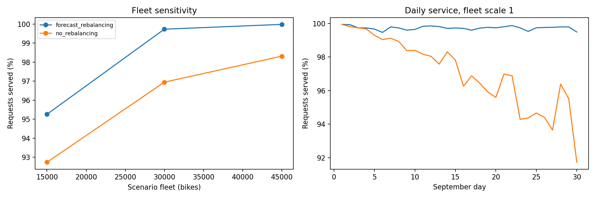

# Bike Sharing: Next-Day Forecasting and Rebalancing

A practicum pipeline that predicts station-level next-day pickups and returns, optimizes daily bike transfers, and compares two inventory policies over 30 consecutive days using April–September 2019 Citi Bike trip histories.

## Implemented workflow

1. Audit and aggregate historical trip records into station-hour counts.
2. Compare seasonal-naive, historical weekday mean, and recent weekday mean forecasts using rolling August validation.
3. Initialize station inventories from August patterns and evaluate three fleet sizes.
4. Optimize transfers toward forecast-based targets under a daily movement cap.
5. Replay September requests with and without rebalancing, preserving linked returns and bikes in transit.
6. Export forecast errors, service levels, unmet requests, station availability, transfers, and figures.

## Run

Tested with Python 3.12.7. From the repository root:

```bash
python -m venv .venv
source .venv/bin/activate
python -m pip install -r requirements.txt
python -m unittest discover -s tests -v
python src/bike_project.py
```

Raw trip files are not included. See [DATA.md](DATA.md) and [data_manifest.txt](data_manifest.txt) for input provenance and layout. The preparation step creates a local cache; subsequent runs can use:

```bash
python src/bike_project.py --reuse-prepared --fleet-scales 0.5 1 1.5 --move-fraction 0.1
```

## Files

- [src/bike_project.py](src/bike_project.py): complete pipeline.
- [tests/test_bike_project.py](tests/test_bike_project.py): six tests of allocation, temporal leakage, optimization, and event replay.
- [METHODOLOGY.md](METHODOLOGY.md): assumptions, formulas, evaluation design, and limitations.
- [outputs/next_day/REPORT.md](outputs/next_day/REPORT.md): executed results.
- [outputs/next_day/forecast_metrics.csv](outputs/next_day/forecast_metrics.csv): forecast comparisons.
- [outputs/next_day/simulation_summary.csv](outputs/next_day/simulation_summary.csv): policy comparisons.

## Initial results

The executed replay covers 841 stations and 2,431,500 September requests. With the reference scenario fleet of 29,983 bikes, service was 96.95% without rebalancing and 99.73% with forecast-based rebalancing. All 180 scenario-days passed fleet conservation assertions.



## Interpretation and limitations

This is a first implementation and historical-trip replay experiment. Recorded trips represent historically served demand, not all attempted requests. Initial inventory is a scenario assumption, not a reconstruction of the actual fleet. Rebalancing is instantaneous at midnight and limited by a movement budget; costs are straight-line bike-km, not truck routes or monetary costs. Forecasts use fixed historical averages rather than fitted autoregressive or machine-learning models. September was previously explored and is not an untouched test set.

Broader chronological evaluation, initialization and budget sensitivity, a non-predictive rebalancing control, and validation against historical station inventories remain future work. The earlier milestone notebook belongs to the separate original project and is not included here.
